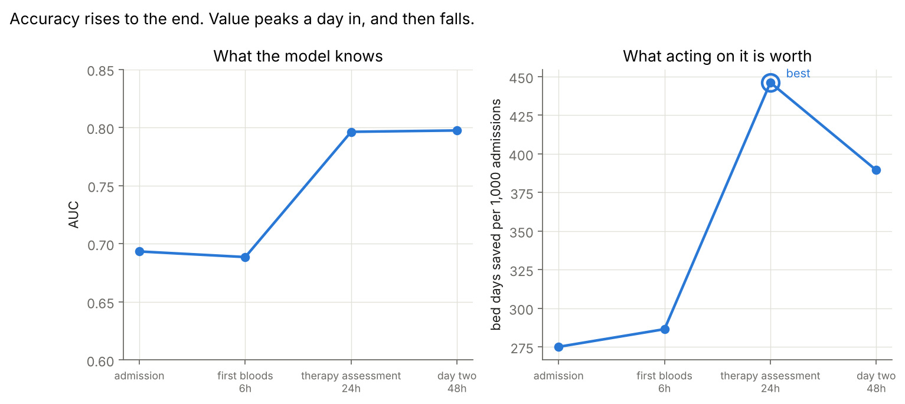

# Earlier discharge planning: when is a prediction worth acting on?

[](https://github.com/jackcormacwright1/earlier-discharge-planning/actions/workflows/tests.yml)

A length-of-stay model gets more accurate the longer you wait. The thing you would do with it — start
discharge planning early — gets less useful the longer you wait. Somewhere between those two curves is the
moment to make the call, and it is not where the accuracy curve tells you to look.

This project finds that moment, and in doing so runs into two things that matter more than the model.



## Three findings

**1. The accuracy curve and the value curve point in opposite directions.** Discrimination for the model
rises from 0.693 at admission to 0.796 once the therapy assessment lands at 24 hours, and then sits flat at
0.797 on day two. Pick the decision point by AUC and you would wait until day two — and lose 13% of the
benefit, because by then the referral has two fewer days to do anything. The value peaks at 24 hours and
falls away after it.

**2. Changing the label is worth more than changing the model.** A length-of-stay label is the one always
to hand, and it is mostly a measure of how ill somebody is. The benefit of earlier discharge planning goes
to a different group: the people whose discharge will be held up by something that is not their illness.
Same features, same learner, different label:

| Predictor | Best decision point | Bed days saved per 1,000 admissions | Share of what was available |
|---|---|---|---|
| **Model trained on delayed discharge** | 24h | **446** | 68% |
| Ward rule (age, care home, lives alone, prior admissions) | admission | 303 | 46% |
| Model trained on long stay | 48h | 185 | 28% |
| Logistic regression on long stay | 24h | 188 | 29% |
| Unselected referral | — | 163 | 25% |

All at 200 referrals per 1,000 admissions, the capacity cap. Swapping the label is worth 2.4 times as much
as swapping logistic regression for gradient boosting on the wrong one.

**3. At admission, a rule you could write on a whiteboard beats every model.** 303 bed days against 275 for
the best model. The model only overtakes it when the first therapy assessment arrives — which is to say,
when the record first contains something about going home rather than about being ill.


## The thing the answer turns on

The Cochrane review measured the effect of *doing* discharge planning, not of doing it **earlier**. No trial
randomised the timing, so how fast the benefit decays is an assumption with nothing behind it. It is
therefore the axis everything is reported against, rather than a number buried in a config file.


The answer is stable: if the useful window is three days or longer, wait for the therapy assessment at 24
hours. Only if the window is under three days should you flag at admission, and only if timing is
*completely* irrelevant should you wait until day two. The interior optimum survives every one-at-a-time
variation except two — a tighter capacity cap, and a world where discharge complexity is 80% foreseeable
from admission variables, both of which push the decision later.


## An inconvenient arithmetic result

The benefit has to come out of delay that earlier planning could actually remove. At the central
assumptions the cohort contains **0.656 days per patient** of shortenable delay, against a Cochrane effect
of **0.73 days**. The published effect is larger than the entire pool it would have to come from.

Which means one of these is true: more than half of delayed discharges are shortenable by starting sooner
(the calibration needs 56%), or discharge planning also shortens ordinary stays rather than only delayed
ones, or the trial effect does not transfer to a cohort with these delay statistics. The analysis caps the
benefit at what exists and reports when the cap binds. It is not a comfortable result and it is not hidden.

## Why this is simulated, and what that buys

The question is not how accurate a length-of-stay model can be — that is a property of a dataset, and
several public ones would answer it. The question is *when enough is known to act*, which is a property of
the process: what exists at admission, what arrives with the first bloods, what only appears when a
therapist assesses someone's mobility. No public dataset lets you vary that schedule, and varying it is the
entire point.

So the schedule is modelled explicitly and the cohort is pinned to published national figures rather than
invented. From the National Audit Office's 2026 report on patient flow (2025-26, emergency admissions from
A&E): mean length of stay 8.1 days, 14.2% of stays involving a delayed discharge, 3.7% a delay of seven
days or more, and patients well enough to go home using 14.7% of all bed days. Two free parameters, two
targets, solved rather than assumed — `scripts/01_calibrate.py` re-derives them.

| | Realised | Published target |
|---|---|---|
| Mean length of stay | 8.10 | 8.1 |
| Share with any delayed discharge | 0.142 | 0.142 |
| Share with a delay of 7+ days | 0.037 | 0.037 |
| Share of bed days lost to delay | 0.153 | 0.147 |

## The economics

| | Central | Range | Basis |
|---|---|---|---|
| Marginal bed day | £400 | £250–800 | the day saved is a medically-fit day, not an average one |
| Discharge planning effect | 0.73 days | 0.12–1.33 | Cochrane, 11 trials, 2,113 participants |
| Referral cost | £70 | £30–150 | ~2h of a band 6 coordinator, fully loaded |
| Useful window *L* | 7 days | 2–∞ | assumed; the axis everything is reported against |
| Capacity | 200 per 1,000 | 100–400 | the constraint that actually binds |

On pure cash, targeting is pointless: at £70 a referral against £400 a bed day, a false positive costs
almost nothing and you should refer everyone. The constraint in a real hospital is the size of the
discharge team, and under a capacity cap a false positive is no longer cheap — it displaces a true one.
That is the version modelled here.

As a cross-check on the £400: NHS England put the cost of delayed discharges at £229m in April 2026 against
408,350 bed days, which implies **£561 a day**. The central case is conservative.

## What's here

| | |
|---|---|
| `src/eds/simulate.py` | the cohort: length of stay split into clinical days and discharge delay, with information arriving in tranches |
| `src/eds/predict.py` | a model per decision point, using only what exists by then, on both labels |
| `src/eds/economics.py` | what a referral is worth, the decay, the capacity cap |
| `scripts/01_calibrate.py` | solves the delay distribution from the published targets |
| `scripts/02_run.py` | every number quoted above |
| `scripts/03_figures.py` | every chart |
| `tests/test_core.py` | 11 tests, including the central claim as a regression test |
| `docs/METHODOLOGY.md` | the model, the assumptions, and what this design cannot tell you |

## Running it

```bash
pip install -e ".[dev]"
PYTHONPATH=src python scripts/01_calibrate.py   # re-derive the delay distribution
PYTHONPATH=src python scripts/02_run.py         # results/*.csv
PYTHONPATH=src python scripts/03_figures.py     # results/*.png
pytest
```

## Sources

- National Audit Office (2026), [*Managing the flow of patients through hospital from
  A&E*](https://www.nao.org.uk/wp-content/uploads/2026/09/Managing-the-flow-of-patients-through-hospital-from-AE-Summary.pdf).
- Gonçalves-Bradley et al., [*Discharge planning from
  hospital*](https://www.cochrane.org/evidence/CD000313_discharge-planning-hospital), Cochrane Database of
  Systematic Reviews.
- Nuffield Trust, [*Delayed discharges from
  hospital*](https://www.nuffieldtrust.org.uk/resource/delayed-discharges-from-hospital).
