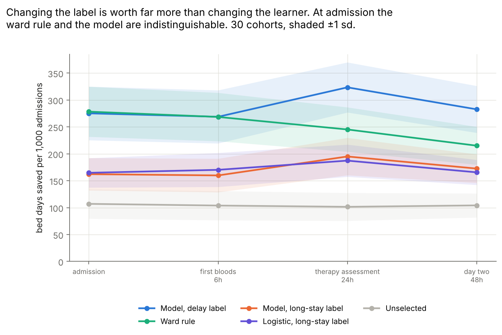
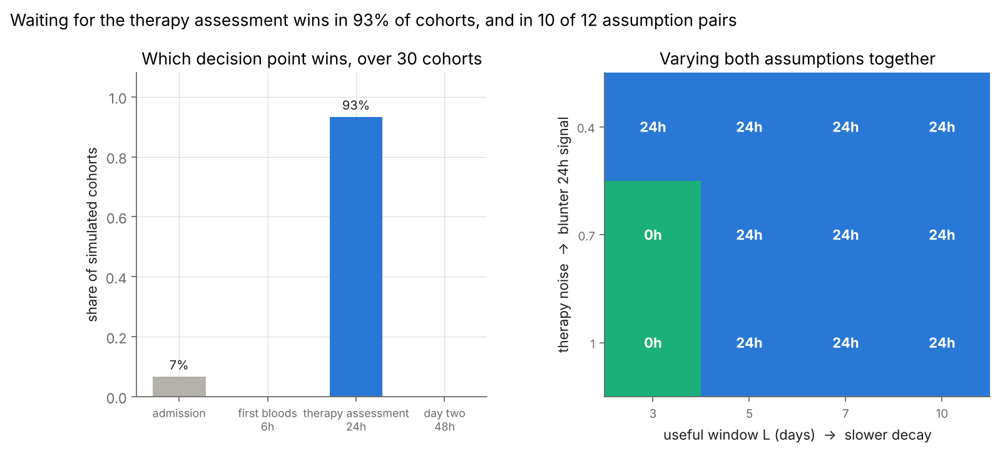
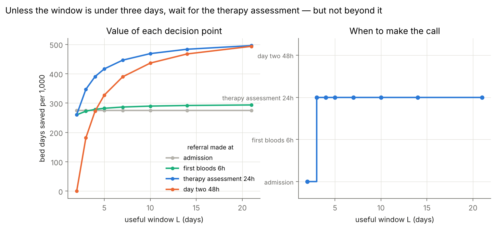
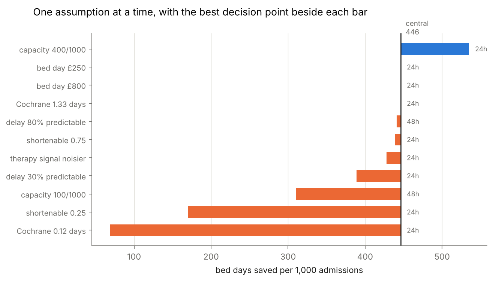

# Earlier discharge planning: when is a prediction worth acting on?

[](https://github.com/jackcormacwright1/earlier-discharge-planning/actions/workflows/tests.yml)

A length-of-stay model gets more accurate the longer you wait. The thing you would do with it — start
discharge planning early — gets less useful the longer you wait. Somewhere between those two curves is
the moment to make the call, and it is not where the accuracy curve tells you to look.

## This is a simulation study. Read this first.

There is no patient data here. The cohort is generated by a model whose assumptions determine the
answer, so the assumptions come before the findings rather than after them.

**What is assumed.** Information arrives in tranches: demographics and history at admission, bloods and
observations at 6 hours, therapy assessment and planned procedures at 24 hours, social work and
placement flags at 48 hours. Discharge complexity — the thing that actually drives delay — is 55%
foreseeable from admission variables but blurred, invisible in the 6-hour bloods *by construction*,
visible with noise 0.70 at 24 hours, and visible with noise 0.40 at 48 hours. So the later signal is the
**better** one; what makes waiting costly is a separate assumption, that the benefit of planning decays
over a useful window of 7 days.

**What that means for the headline.** "24 hours" is the best decision point *under this information
schedule and this decay assumption*. It is not an empirical finding about hospitals. Those two
assumptions are varied, individually and together, in the stability section below, and the answer is
reported as how often each decision point wins rather than which one won once.

**What the design buys.** The question is not how accurate a length-of-stay model can be — that is a
property of a dataset, and several public ones would answer it. The question is *when enough is known to
act*, which is a property of the process. No public dataset lets you vary the information schedule, and
varying it is the entire point.

**What is pinned to reality.** The cohort's marginals, not its mechanism. From the National Audit
Office's 2026 report on patient flow (2025-26, emergency admissions from A&E): mean length of stay 8.1
days, 14.2% of stays involving a delayed discharge, 3.7% a delay of seven days or more, and patients
well enough to go home using 14.7% of all bed days. Two free parameters, two targets, solved rather than
assumed — `scripts/01_calibrate.py` re-derives them.

| | Realised | Published target |
|---|---|---|
| Mean length of stay | 8.10 | 8.1 |
| Share with any delayed discharge | 0.142 | 0.142 |
| Share with a delay of 7+ days | 0.037 | 0.037 |
| Share of bed days lost to delay | 0.153 | 0.147 |

**Every number below is a mean over 30 simulated cohorts**, each resimulated and refitted from scratch,
with the spread reported. An earlier version of this README quoted one cohort; that cohort turned out to
be the most favourable of the thirty, and one of its three findings did not survive repetition.

## Three findings

**1. The accuracy curve and the value curve point in opposite directions.** Discrimination for the
delay-label model rises from 0.690 at admission to 0.788 once the therapy assessment lands at 24 hours,
and then sits flat at 0.789 on day two. Pick the decision point by AUC and you would wait until day
two — day two is nominally the most accurate — and lose 13% of the benefit, because by then the referral
has two fewer days to do anything. Waiting from 24 to 48 hours buys +0.001 of AUC and costs 41 bed days
per 1,000 admissions.


**2. Changing the label is worth far more than changing the learner.** A length-of-stay label is the one
always to hand, and it is mostly a measure of how ill somebody is. The benefit of earlier discharge
planning goes to a different group: the people whose discharge will be held up by something that is not
their illness.

| Predictor | Best decision point | Bed days saved per 1,000 | sd across cohorts |
|---|---|---|---|
| **Model trained on delayed discharge** | 24h | **323.5** | 46.5 |
| Ward rule (age, care home, lives alone, prior admissions) | admission | 278.3 | 46.6 |
| Model trained on long stay | 24h | 195.1 | 34.7 |
| Logistic regression on long stay | 24h | 187.3 | 29.9 |
| Unselected referral | admission | 107.0 | 27.4 |

All at 200 referrals per 1,000 admissions, the capacity cap. Compared **within** each cohort, which is
the right comparison because the cohort draw moves every predictor together:

| Swap | Mean difference | Positive in |
|---|---|---|
| Label: delayed-discharge instead of long-stay, same learner, same hour | **+128.4** | **100% of cohorts** |
| Learner: gradient boosting instead of logistic regression, same label, same hour | +7.7 | 63% of cohorts |

Changing the label gains 128 bed days per 1,000 in every single cohort. Changing the learner gains 8, and
does so barely more often than a coin toss. This is the finding the project is really about.



**3. At admission a model has nothing a ward rule does not already have — but the advantage appears the
moment the therapy assessment lands.** At admission the ward rule saves 278.3 bed days per 1,000 and the
best model saves 275.2: a paired difference of +3.1 in the rule's favour, and the rule wins in 53% of
cohorts. That is a coin toss, not a result.

*An earlier version of this README claimed the ward rule beat every model at admission, 303 against 275.
That was a single cohort, and repetition does not support it. What survives is the weaker and more useful
statement: at admission there is nothing to choose between them, so the model earns its place only once
the record contains something about going home rather than about being ill.* Measured that way, the best
model at 24 hours beats the ward rule at admission by 45.2 bed days per 1,000, in 97% of cohorts.

## How stable is "24 hours"?

Across 30 cohorts at the central assumptions, 24 hours is the best decision point in **93%**, and
admission in the other 7%. Varying the two assumptions the answer actually turns on — how clear the
24-hour signal is, and how fast the benefit decays — **together** rather than one at a time, 24 hours
wins in 10 of 12 combinations. Admission only wins when the window is as short as three days *and* the
24-hour signal is blunt; sharpen the signal and 24 hours wins even at a three-day window.



One-at-a-time sensitivity cannot see that interaction, and the interaction is the interesting part: the
value of waiting for a signal depends on how good the signal is *and* on how much time waiting costs, and
neither assumption decides it alone.

The two charts below are the older one-at-a-time analysis, and unlike everything above they are computed
from a **single cohort**. They are kept because the shape of the decay sweep is informative, but the
grid above supersedes the "under three days, flag at admission" reading of the left-hand panel: whether
that holds depends on how sharp the 24-hour signal is, which a one-at-a-time sweep holds fixed without
saying so.





## An inconvenient arithmetic result

The benefit has to come out of delay that earlier planning could actually remove. At the central
assumptions the cohort contains **0.656 days per patient** of shortenable delay, against a Cochrane
effect of **0.73 days**. The published effect is larger than the entire pool it would have to come from.

Which means one of these is true: more than half of delayed discharges are shortenable by starting sooner
(the calibration needs 56%), or discharge planning also shortens ordinary stays rather than only delayed
ones, or the trial effect does not transfer to a cohort with these delay statistics. The analysis caps the
benefit at what exists and reports when the cap binds. It is not a comfortable result and it is not hidden.

## The economics

| | Central | Range | Basis |
|---|---|---|---|
| Marginal bed day | £400 | £250–800 | the day saved is a medically-fit day, not an average one |
| Discharge planning effect | 0.73 days | 0.12–1.33 | Cochrane, 11 trials, 2,113 participants |
| Referral cost | £70 | £30–150 | ~2h of a band 6 coordinator, fully loaded |
| Useful window *L* | 7 days | 2–∞ | assumed; the axis everything is reported against |
| Capacity | 200 per 1,000 | 100–400 | the constraint that actually binds |

The Cochrane review measured the effect of *doing* discharge planning, not of doing it **earlier**. No
trial randomised the timing, so how fast the benefit decays is an assumption with nothing behind it. It
is therefore an axis rather than a number in a config file.

On pure cash, targeting is pointless: at £70 a referral against £400 a bed day, a false positive costs
almost nothing and you should refer everyone. The constraint in a real hospital is the size of the
discharge team, and under a capacity cap a false positive is no longer cheap — it displaces a true one.
That is the version modelled here.

As a cross-check on the £400: NHS England put the cost of delayed discharges at £229m in April 2026
against 408,350 bed days, which implies **£561 a day**. The central case is conservative.

## What's here

| | |
|---|---|
| `src/eds/simulate.py` | the cohort: length of stay split into clinical days and discharge delay, with information arriving in tranches |
| `src/eds/predict.py` | a model per decision point, using only what exists by then, on both labels |
| `src/eds/economics.py` | what a referral is worth, the decay, the capacity cap |
| `scripts/01_calibrate.py` | solves the delay distribution from the published targets |
| `scripts/02_run.py` | one cohort in detail |
| `scripts/04_stability.py` | 30 cohorts, the paired comparisons, and the two assumptions varied together |
| `scripts/03_figures.py` | every chart |
| `tests/test_core.py` | the findings as regression tests |
| `docs/METHODOLOGY.md` | the model, the assumptions, and what this design cannot tell you |

## Running it

```bash
pip install -e ".[dev]"
PYTHONPATH=src python scripts/01_calibrate.py   # re-derive the delay distribution
PYTHONPATH=src python scripts/02_run.py         # one cohort -> results/*.csv
PYTHONPATH=src python scripts/04_stability.py   # 30 cohorts -> results/seed*.csv
PYTHONPATH=src python scripts/03_figures.py     # results/*.png
pytest
```

## What this cannot tell you

The information schedule is assumed, not measured, and it determines the answer. A real version of this
analysis would take the schedule from a hospital's own record timestamps — when the first therapy
assessment is actually filed, how often it is late — and the right next step is to replace the assumed
schedule with an empirical one rather than to refine the model fitted to the assumed one.

A natural extension, not done here: compare these fixed-time policies against a mixed one that refers the
highest-risk patients at admission and reassesses the rest at 24 hours, under the same total referral
budget. Nothing in this design forces a single decision point for everybody, and the fact that admission
wins in 7% of cohorts suggests the best policy may not be a fixed time at all.

## Sources

- National Audit Office (2026), [*Managing the flow of patients through hospital from
  A&E*](https://www.nao.org.uk/wp-content/uploads/2026/09/Managing-the-flow-of-patients-through-hospital-from-AE-Summary.pdf).
- Gonçalves-Bradley et al., [*Discharge planning from
  hospital*](https://www.cochrane.org/evidence/CD000313_discharge-planning-hospital), Cochrane Database of
  Systematic Reviews.
- Nuffield Trust, [*Delayed discharges from
  hospital*](https://www.nuffieldtrust.org.uk/resource/delayed-discharges-from-hospital).
